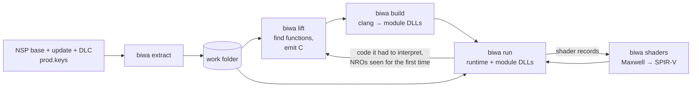
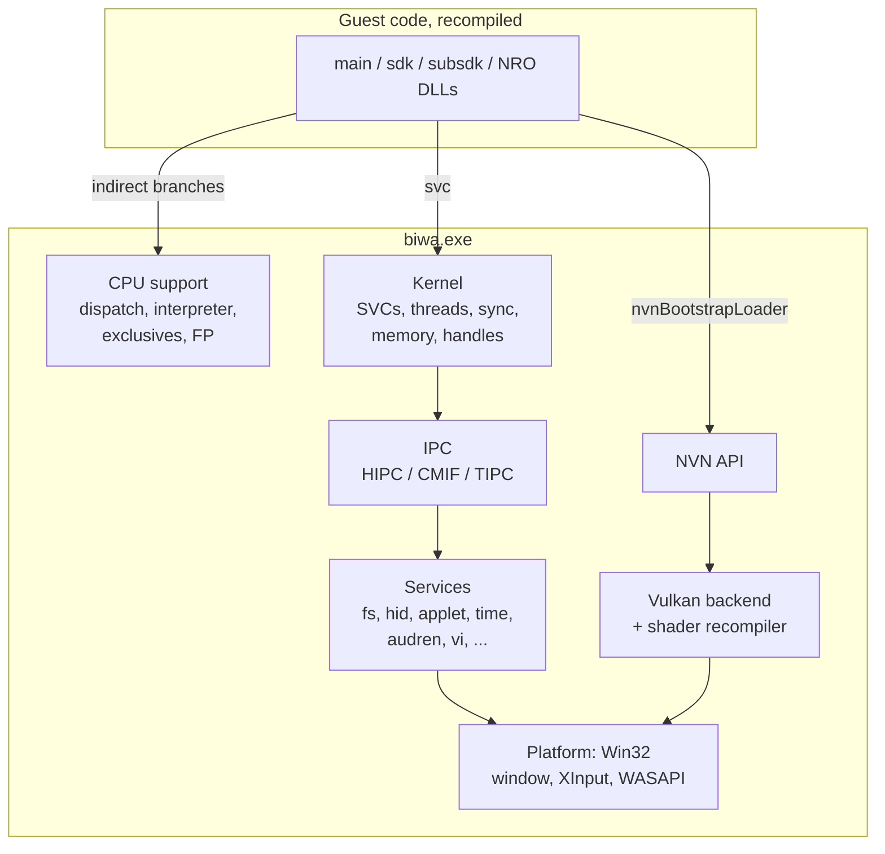

# 00 — Overview

## Goal

Run Switch games as native Windows x64 programs, built on the player's PC from the player's own dump:

- The game's AArch64 code is recompiled ahead of time: AArch64 → C → x64 with Clang.
- Biwa implements the Switch's operating system (Horizon) itself: the kernel's SVCs, the IPC services, and the NVN graphics API on Vulkan.
- The core is game-agnostic, so a new game costs a profile and the services it is missing, not a new runtime.

## Non-goals

- Platforms other than Windows x64. Linux x64 builds exist only to run tests.
- Switch 2 games (NVN2), online play, local wireless play.
- Games that generate code at run time (JIT).
- Accuracy for its own sake: Biwa implements what games observe, and checks it against real behaviour.
- Shipping anything derived from a game.

## The pipeline

1. **Extract** ([03](03-extract.md)) decrypts and unpacks the game into a work folder: the ExeFS modules (`rtld`, `main`, `sdk`, `subsdk*`), one RomFS image with the update applied, DLC RomFS images, and metadata.
2. **Lift** ([04](04-cpu-recompiler.md)) finds every function it can in each module and writes C: one C function per guest function.
3. **Build** compiles the C with the same Clang into one DLL per guest module.
4. **Run** ([05](05-runtime-os.md)): `biwa.exe` maps the modules at fixed guest addresses, loads their DLLs, and starts the game's first thread.
5. Code that lifting missed runs on the **interpreter**. Its addresses go into a coverage file, and the next lift picks them up. NROs loaded through `nn::ro` that have no DLL yet are saved the same way and lifted on the next build.
6. **Shaders** ([07](07-shaders.md)): each shader the game uses is translated to SPIR-V when first seen. Its environment (code and the state it read) is recorded, so later runs can rebuild and pre-compile every pipeline before play.

## The process at run time

## Main decisions

| Decision | Choice | Where |
|---|---|---|
| Target | Windows x64 only; Linux x64 builds for tests | [01](01-build-and-toolchain.md) |
| Toolchain | CMake + Ninja, Clang (llvm-mingw, MinGW target with UCRT), PDB debug info | [01](01-build-and-toolchain.md) |
| CPU | Static recompilation AArch64 → C; interpreter fallback; identity-mapped guest memory | [04](04-cpu-recompiler.md) |
| OS level | Kernel at the SVC level, services at the IPC level; NVN replaced at its API | [05](05-runtime-os.md) |
| Graphics | Vulkan 1.3; NVN objects translated to Vulkan | [06](06-gpu-nvn-vulkan.md) |
| Shaders | yuzu's shader recompiler (Maxwell → SPIR-V), ported in | [07](07-shaders.md) |
| Extraction | Biwa's own code (written fresh) | [03](03-extract.md) |
| Third-party code | Well-established projects only, pinned, GPL-3.0-compatible | [02](02-dependencies.md) |

## Principles

- **Small steps.** Each change is small, builds, and has a test or a run that shows it works. The [roadmap](11-roadmap.md) is written as such steps.
- **Fail fast and loudly.** An unimplemented SVC, service command or NVN function stops the game with one line naming it, its caller and a guest backtrace. Silent success-stubs hide bugs for weeks.
- **One source of truth for instruction semantics.** The lifter's generated C and the interpreter call the same semantic functions, so they cannot disagree.
- **Game-agnostic core, per-game profiles.** Anything game-specific (module layout quirks, takeovers, fps patches, shader sources) lives in `games/<title id>.json`, never in the core.
- **Measured optimisation.** Correct first, then profile real games on real hardware, then optimise what the profile shows.

## Data policy

- The repository and releases contain no game code, assets, keys, firmware, generated C, shaders or caches.
- Tests use synthetic inputs: formats built by the tests themselves, and small AArch64 test programs assembled from source in this repository ([09](09-testing-and-debugging.md)).
- Runs on real games happen on the owner's machine. Logs shared in issues must not contain game data beyond addresses and names.

## Glossary

| Term | Meaning |
|---|---|
| Module | An executable image: NSO (`rtld`, `main`, `sdk`, `subsdk*`) or NRO (loaded at run time through `nn::ro`) |
| Guest | The game's code and data, as on the Switch |
| Host | Biwa and Windows |
| Lift | Translating guest machine code to C |
| Module DLL | The compiled C for one guest module |
| SVC | A Horizon kernel call (`svc #n`) |
| HIPC / CMIF / TIPC | Horizon's IPC message format, its command layer, and the simpler command layer `sm` uses on newer firmware |
| NVN | The Switch's native graphics API |
| Takeover | A guest function replaced by a host function (kept rare: `nvnBootstrapLoader` is the main one) |
| Shader record | A shader's code plus everything the translator read while translating it, enough to translate it again offline |
| Work folder | Per-game folder holding the extracted game and everything Biwa builds from it |
