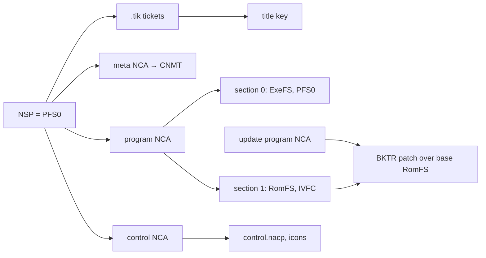

# 03 — Extract

`biwa extract` turns the player's dump into a work folder. It is Biwa's own code, written fresh, in the library `biwa::nx` (`src/nx`) plus the `biwa` command.

## Inputs

- The base game NSP, the latest update NSP, and any DLC NSPs. XCI (game card) dumps come later, when someone needs them.
- `prod.keys`, and optionally `title.keys`. Biwa reads **derived** keys only: `header_key`, `key_area_key_application_XX`, `titlekek_XX`. It does not derive keys from console secrets.
- Keys are never printed, logged, or written into the work folder. Error messages name the missing key (`titlekek_0f`), never a value.

## What it reads



| Step | Detail |
|---|---|
| PFS0 | NSP container: file table, string table, data |
| Tickets | Common tickets: title key = AES-ECB-decrypt(`titlekek[generation]`, ticket's key). Personalised tickets (console-unique RSA) are refused with exit code 5 and a hint to dump with console data removed |
| NCA header | 0xC00 bytes, AES-XTS with `header_key`, 0x200-byte sectors numbered from 0; magic `NCA3` (NCA2 only if a game needs it). Master key index = max(old key generation, new key generation) − 1, or 0 when both are 0 |
| Section keys | Rights ID set → the ticket's title key; otherwise the key area decrypted with `key_area_key_application[generation]` |
| Section crypto | None, AES-CTR (counter = the section's 8-byte nonce + offset / 16), AES-CTR-Ex (BKTR: counter generation per bucket entry), AES-XTS (rare) |
| Hashes | HierarchicalSha256 (ExeFS) and IVFC (RomFS, SHA-256 per block). Checked during extraction unless `--no-verify` |
| Update | BKTR: an indirect storage (bucket tree mapping each virtual range to the base or the patch) over the base RomFS and the update's data, with AES-CTR-Ex. The update's ExeFS replaces the base's |
| Compressed sections | LZ4 blocks described by a bucket tree, over the hash layer (newer titles). Supported |
| Sparse sections | Reported as unsupported until a game needs them |
| CNMT | From the meta NCA: title ID, version, content list, required system version |
| DLC | Each add-on content NCA's RomFS is one image, by its add-on index |

## Storage model

Every layer is a read-only, thread-safe `Storage` with `Read(offset, span)`: file, sub-range, AES-CTR, AES-CTR-Ex, AES-XTS, indirect (BKTR), compressed, hash-checked. A section is a stack of them. Extraction copies the top storage to a file in 8 MiB pieces over N threads, so a 15 GB RomFS is a streaming job with no temporary copies.

## The work folder

One per title:

```
<work>/
  manifest.json        title ID, base and update versions, DLC list, key generations, content IDs,
                       SHA-256 of every output, the Biwa version that wrote it
  exefs/               main, main.npdm, rtld, sdk, subsdk0..9 as stored (NSO)
  modules/<name>.bin   each NSO decompressed to its memory image (.text, .rodata, .data at their offsets)
  modules/<name>.json  build ID, segment offsets and sizes, .bss, MOD0, .dynamic, .eh_frame_hdr range
  romfs.bin            the RomFS with the update applied, decrypted, in the standard RomFS layout
  aoc/<index>.bin      DLC RomFS images
  control/             control.nacp, icon_<language>.jpg
  npdm.json            main thread priority, stack size, ideal core, address space type, SVC mask
```

Later tools add `lift/`, `gen/`, `build/`, `coverage/`, `nro/`, `shaders/`, `save/` and `logs/`. Their formats are in the documents for those tools.

`romfs.bin` is the RomFS exactly as the game sees it, so the runtime's file system service reads it with the same RomFS parser the tests use, and directory order and file offsets match the console. `biwa romfs ls` and `biwa romfs cat` let a person look inside without extracting a second copy.

## NSO and NPDM

- NSO: header, three segments (each LZ4-compressed or not, with SHA-256), the 0x20-byte module (build) ID, `.bss` size, the MOD0 header (`.dynamic`, `.bss`, `.eh_frame_hdr`). The build ID names the module everywhere else (`<name>-<build id>.dll`, caches).
- NPDM: META (main thread priority, stack size, ideal core, address space type), ACI0 / ACID kernel capabilities (SVC mask, allowed cores and priorities). The runtime uses these values, and the SVC mask tells the lifter which SVCs can appear.

## Command

```
biwa info [-k prod.keys] [--verify] <file.nsp>
biwa extract -k prod.keys [-t title.keys] -o <work> <base.nsp> [<update.nsp>] [<dlc.nsp> ...]
             [--no-verify] [-j N]
biwa romfs ls  [-k prod.keys] [-r] <file> [path]
biwa romfs cat [-k prod.keys] [-o out] <file> <path>
```

`romfs` reads a work folder, a RomFS image, or an NSP directly (its program or add-on data NCA, with `-k`).

| Exit code | Meaning |
|---|---|
| 0 | Done |
| 1 | Usage error |
| 2 | Input not found or not a Switch file |
| 3 | Damaged (hash mismatch, bad magic, truncated) |
| 4 | Missing keys |
| 5 | Unsupported (personalised ticket, sparse section, NCA2) |

## Tests

All synthetic, built by the tests with made-up keys: PFS0 and NCA builders, tickets, sections of every crypto type, IVFC and HierarchicalSha256 trees, a BKTR patch over a base, compressed sections, CNMT, NSO with and without compression. Damage tests flip bits and expect exit code 3; missing-key tests expect 4 and a message without key bytes. Tests never read real game files.

## Open questions

- XCI support (HFS0, secure partition): small, added when a dump needs it.
- Whether `extract` should also lay out save data imported from the console (`save/`), or leave that to a separate `biwa save import`.
