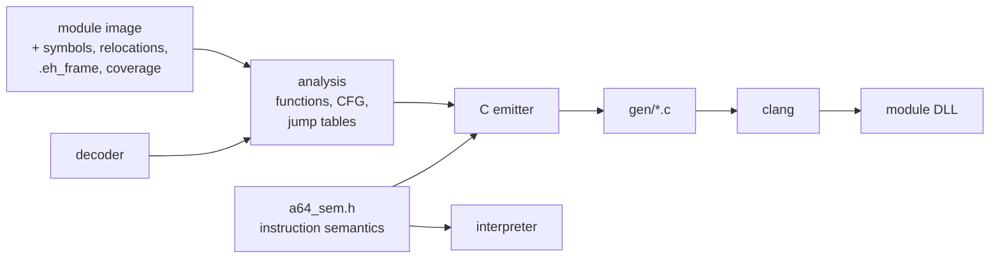

# 04 — CPU recompiler

The game's AArch64 code becomes C ahead of time; Clang compiles that C to x64. The runtime supplies what C cannot express by itself: indirect branches, system calls, exclusive monitors, the FP environment, and an interpreter for code the lifter did not find.

## Scope

The A64 instructions a Switch game can execute at EL0 on the Cortex-A57 (ARMv8.0-A):

- Integer, loads and stores (all addressing modes, pairs, exclusives, acquire/release), branches.
- FP and AdvSIMD (NEON), including FP16 conversions.
- The crypto extension (AES, SHA-1, SHA-256, PMULL) and CRC32, which the SDK's crypto code may use.
- EL0 system registers: `TPIDR_EL0`, `TPIDRRO_EL0`, `CNTPCT_EL0`, `CNTVCT_EL0`, `CNTFRQ_EL0`, `FPCR`, `FPSR`, `NZCV`, `DCZID_EL0`, `CTR_EL0`.
- Not needed: ARMv8.1+ (LSE atomics, RDM), SVE, A32/T32.

## Pieces



### Decoder

- Generated from a table of bit patterns, starting from dynarmic's `a64.inc` (0BSD), with each entry naming an instruction and its fields. `third_party/dynarmic/a64_extra.inc` adds the ARMv8.0 entries `a64.inc` leaves commented out (scalar and vector SQDMLAL, SQDMLSL, SQRSHL, UQRSHL, scalar SQDMULL and the saturating rounding narrows).
- Checked against Capstone: every encoding Capstone decodes either decodes in Biwa or is on an explicit "not supported" list (`tests/a64/sweep.cpp`), each entry with its reason: an extension after ARMv8.0 (LSE, RDM, pointer authentication, half-precision arithmetic, dot product, MTE, SVE, SME, ...), not available at EL0 (`tlbi`, `at`, `hvc`, system registers outside op0 2–3, ...), `udf`, or bits the architecture says should be one or zero set otherwise (Capstone ignores them; compilers never emit them). `a64_test` checks a spread-out sample of 2^20 encodings on every run; `a64_sweep` checks all 2^32 (about ten minutes on two cores).
- Biwa's table accepts some encodings Capstone rejects: reserved field values (a vector arrangement that does not exist, a shift type of 3, ...) that the A64 manual makes UNDEFINED. The semantics reject them, so they raise an undefined-instruction exception like on hardware.

### Semantics: one source of truth

- `src/a64/a64_sem.h` is C17 with `static inline` functions, one per instruction form: `sem_add_ext`, `sem_ldp_post`, `sem_fmla_vec`, …
- The C emitter writes calls to them, and the interpreter calls the same functions, so lifted code and the interpreter cannot disagree.
- Clang inlines them in generated code. Hot ones can get hand-written fast paths later; the slow version stays the reference in tests.

### CPU state

```c
typedef struct BiwaCpu {
    uint64_t x[31], sp, pc;
    uint32_t nzcv, fpcr, fpsr;
    __attribute__((aligned(16))) uint8_t v[32][16];
    uint64_t tpidr_el0, tpidrro_el0;
    struct { uint64_t addr, lo, hi; uint8_t size, valid; } excl;   /* exclusive monitor */
    struct BiwaThread *thread;                                     /* runtime side */
} BiwaCpu;
```

One per guest thread, owned by the runtime, reached through a host `thread_local` (1.4 ns per access with Clang).

## Analysis: finding functions

Entry points, in order of trust:

1. The module entry and exported dynamic symbols (`STT_FUNC`).
2. `.eh_frame` FDEs: each `pc_begin` is a function start (the SDK and most games are built with unwind tables).
3. Direct call targets (`BL`).
4. Relocation targets in `.text`: `R_AARCH64_RELATIVE` and `ABS64` values that point at code, such as vtables and function-pointer tables.
5. `ADR` / `ADRP + ADD` constants that point into `.text` and decode as code.
6. Addresses from `coverage/<module>.tsv`, written by earlier runs (below).
7. Extra entries from the game profile.

Then recursive descent builds each function's control-flow graph:

- `B` to another known entry is a tail call; conditional branches stay inside the function.
- `BR` is a jump table if it matches the compiler's pattern (bounds check `CMP` + `B.HI`, table base from `ADRP`/`ADR`, element load, add, `BR`). The table is read from the image and each target becomes a block. Otherwise `BR` is an indirect tail call.
- `RET` returns. Code shared by two functions is emitted in both.

`biwa lift --explain <address>` prints how an address was found, its function, blocks and disassembly.

## Generated C

One C function per guest function: `void f_0000000008123450(BiwaCpu *c)`, with each block a label.

| Guest | Generated C |
|---|---|
| Register | Phase 1: `c->x[n]`. Phase 2: live registers held in C locals inside the function, written back before calls and exits |
| Flags | Phase 1: computed at each flag-setting instruction. Phase 2: computed only when something reads them |
| Load / store | `ld64(addr)`, `st32(addr, v)`: identity-mapped, `may_alias` and unaligned-safe, compiled to one `mov` |
| `BL` known target | `f_target(c);` then the next block, assuming the callee returns to `LR` |
| `BLR` | `rt_call(c, target)` through dispatch |
| `B` to another function | `[[clang::musttail]] return f_target(c);` |
| `BR` (not a jump table) | `[[clang::musttail]] return rt_jump(c, target);` |
| `RET` | `return;` (the runtime checks `LR` in debug builds) |
| `SVC #n` | `rt_svc(c, n);` |
| `LDXR` / `STXR` and pairs | Monitor in `c->excl`; the store is a compare-and-swap against the loaded value (`cmpxchg16b` for 128-bit pairs); unaligned addresses raise an alignment fault, as on the A57 |
| `LDAR` / `STLR` | Acquire load; sequentially consistent store, since `STLR` may not pass a later `LDAR` (a C release store could) |
| `DMB` / `DSB` / `ISB` | `atomic_thread_fence` of the matching strength |
| `DC ZVA` | Zero the 64-byte block (`DCZID_EL0` reports 64 bytes) |
| `DC` / `IC` maintenance, `YIELD`, `WFE`, `SEV` | No-ops or `_mm_pause` |
| `BRK`, undefined | `rt_trap(c, pc)`: a stop with a report |
| `MRS CNTPCT_EL0` | Host counter scaled to 19.2 MHz |

Generated code is C17 compiled with `-fno-strict-aliasing`, so guest memory accesses and the CPU state never break type-based alias rules.

## Floating point and SIMD

- The rounding mode follows `FPCR`: writing `FPCR` sets the rounding field of the thread's MXCSR. The host's FTZ and DAZ stay off.
- The host computes; the helpers make the result ARM's. NaN operands are handled before the host sees them (the first signalling NaN, else the first quiet one; `FPCR.DN`); an invalid operation's NaN becomes ARM's default NaN (x86's is negative); fused multiply-add uses FMA3, never a separate multiply and add.
- Flush-to-zero is done by the helpers: a denormal operand reads as zero and raises `IDC`; a tiny result becomes zero and raises `UFC` alone (x86 would add `IXC`). ARM detects tininess before rounding, x86 after: a result that rounded to the smallest normal is recomputed rounding towards zero to tell, which costs nothing on other results. With `FZ` set, the helpers save and restore MXCSR's flags around each operation to tell its own flags apart.
- `FPSR`'s cumulative flags: those the host raises gather in MXCSR and are folded into `FPSR` when it is read and when guest code stops; those only the helpers know go to `FPSR` directly. The runtime saves the guest's MXCSR and restores the host's when it leaves guest code (an SVC, a host callback).
- The helpers' host operations are compiled with `#pragma STDC FENV_ACCESS ON` and contraction off, so the compiler neither folds them nor moves them past changes of the rounding mode or flags.
- AdvSIMD uses Clang vector types (`uint8x16`, `float32x4`, …) and SSE / AVX2 intrinsics where Clang does not pick the right instruction.
- Crypto: AES-NI and SHA-NI when the CPU has them, portable C otherwise.

## The module DLL

- Generated C for one module compiles into `<name>-<build id>.dll` ([01](01-build-and-toolchain.md)).
- Its only export, `biwa_module_init(const BiwaRuntimeApi *, BiwaModuleInfo *)`, returns the sorted table of (guest address, host function) and the runtime functions the code calls are reached through `BiwaRuntimeApi`, so a DLL never links against `biwa.exe`.
- The lifter also writes a table from host code ranges back to guest functions, which crash reports and profilers use.

## Dispatch

`rt_call` / `rt_jump` map a guest address to a host function:

1. A per-thread direct-mapped cache (4,096 entries, keyed by address bits).
2. On a miss, binary search in the module's sorted table.
3. Not found: the interpreter.

PLT stubs (`ldr x16, [GOT]; br x16`) start as ordinary dispatch. Once measured, the runtime can resolve each GOT slot once after `rtld` has done the relocations and patch the call into a direct pointer.

## Interpreter and coverage

- The interpreter runs guest instructions from guest memory with the same semantics. When it reaches an address with compiled code, it calls that code; compiled code that reaches an unknown address enters the interpreter.
- Each address where the interpreter starts is appended to `coverage/<module>.tsv`. The next `biwa lift` treats them as entries, so the slow path shrinks with every run.
- The interpreter is also the reference for differential tests ([09](09-testing-and-debugging.md)).

## NROs (modules loaded at run time)

- When the game loads an NRO through the `ro` service, the runtime hashes the image (build ID) and maps it at a fixed address chosen from that build ID in the NRO region ([05](05-runtime-os.md)), so code lifted for that address is valid on every run.
- No DLL for it yet: the image is saved as `nro/<build id>.nro` and runs on the interpreter. `biwa build` lifts every saved NRO next time.
- A second simultaneous instance of the same NRO would need another address. Until a game does that, it stops with a report.

## Leaving functions other than by `RET`

C++ exceptions, `longjmp`, and fibers resume at a guest address with a guest `SP` belonging to a caller further up. In lifted code, those callers are C frames on the host stack. Games built with C++ exceptions need this from the start.

- The guest's own unwinder (recompiled with the SDK) still does the work: it reads `.eh_frame`, finds the landing pad, restores registers and branches there. That final branch arrives at `rt_jump` as an address that is not a function entry.
- The lifter knows every landing pad (from each FDE's LSDA) and every `setjmp` return site. Functions that contain one get a second entry, `f_<addr>_resume(c, pc)`, which jumps to the right block. Their calls go through `rt_guarded_call`, a small C++ wrapper with a `try` / `catch`.
- `rt_jump` throws a host `GuestResume{sp, pc}` exception. Host unwinding removes the C frames in between (generated C is compiled with `-fexceptions`, and every x64 Windows function has unwind data), and the guarded call whose frame owns that guest `SP` catches it and calls the resume entry.
- Cost: only functions with landing pads or `setjmp` sites pay for the guarded calls.
- A homebrew test that throws across three frames, and one that `longjmp`s, are among the first CPU tests.

## Memory accesses

- Guest addresses are host addresses ([05](05-runtime-os.md)): no translation in generated code. The semantics read and write with plain host accesses; unaligned ones are allowed, as for normal memory on the console.
- CONSTRAINED UNPREDICTABLE forms that compilers do not emit (writeback with `Rt == Rn`, `LDP` with `Rt == Rt2`) behave as Unicorn does: the access first, then the writeback; for `LDP`, `Rt` is written last.
- The module's `.text` stays mapped read-only at its guest address, for literal pools, jump tables and the interpreter.
- An access to an unmapped or protected page raises a host access violation. The runtime's vectored exception handler turns it into a guest data abort report: guest PC (from the host-to-guest table), address, registers, guest backtrace.

## Performance plan

1. Correct first: registers in the struct, flags always computed, every indirect branch through dispatch.
2. Registers in locals, flag liveness, direct PLT calls: measured on real games before and after.
3. Guided by profiles on real hardware: hottest functions at `-O3`, hand-written semantic fast paths, possibly per-module LTO.

Compile time matters: a large game's main module can turn into hundreds of megabytes of x64 code, so chunked parallel builds and per-chunk caching ([01](01-build-and-toolchain.md)) are part of the design from the start.

## Open questions

- Whether some game code relies on flags or registers surviving across calls in ways the C calling discipline breaks. A strict mode (all state in the struct, full flags) stays available to test that.
- Fibers: games that use `nn::os` fibers need them as host fibers (`CreateFiber`) holding a guest stack.
