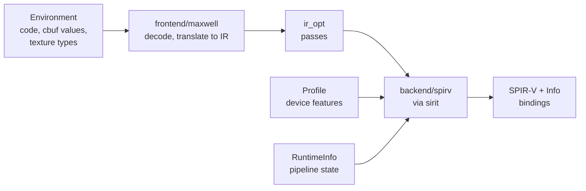

# 07 — Shaders

Switch games ship compiled Maxwell GPU code. Biwa finds each shader the game uses, translates it to SPIR-V with **yuzu's shader recompiler, ported in**, and builds Vulkan pipelines from it, with caches so that later runs compile everything before play.

## What a shader is in NVN

- `nvnProgramSetShaders(program, count, NVNshaderData[])`: each stage gives the GPU address of its code (in a memory pool created for shader code) and a pointer to its control data.
- The code is Maxwell machine code (SM 5.3, Tegra X1). Graphics stages start with the 0x50-byte shader program header (SPH) that yuzu's recompiler reads; compute stages take their workgroup size, shared memory and local memory sizes from the control data.
- Both layouts are confirmed on the first dumped shaders. The control data's layout is not public, so Biwa documents what it learns in `docs/notes/nvn-shader-control.md`.

## The ported recompiler

Source: yuzu's `src/shader_recompiler/` at `7ffac53` ([02](02-dependencies.md)), kept under `third_party/yuzu/` with its notices and an `UPSTREAM.md` of every change.

- Kept: `frontend/`, `ir_opt/`, `backend/spirv/`, and the headers between them.
- Dropped: the GLSL and GLASM back ends.
- Port changes: `common/settings.h` replaced by a small Biwa config struct; the `common/` headers it uses come along ([02](02-dependencies.md)); Boost containers and fmt kept at first (both allowed), replaced only if that later helps; builds with Clang / MinGW; excluded from Biwa's `-Werror`.

What Biwa supplies, in `src/shader/`:

| Interface | Biwa's implementation |
|---|---|
| `Environment::ReadInstruction` | Reads the code from guest memory at the stage's GPU address (a pool's guest address, [06](06-gpu-nvn-vulkan.md)) |
| `ReadCbufValue` | Reads the bound constant buffer's current contents (bindless texture handles) |
| `ReadTextureType`, `ReadTexturePixelFormat`, `IsTexturePixelFormatInteger` | Look the handle up in the bound texture pool |
| `TextureBoundBuffer` | The driver constant buffer slot that holds bound texture handles ([06](06-gpu-nvn-vulkan.md)) |
| `LocalMemorySize`, `SharedMemorySize`, `WorkgroupSize` | From the SPH, or from compute control data |
| `ReadViewportTransformState`, `HasHLEMacroState`, `GetReplaceConstBuffer` | NVN state / false / none |
| `Profile` | Filled once from the Vulkan device's features and limits |
| `RuntimeInfo` | Per pipeline: previous stage's outputs, vertex attribute types, alpha test, point size, transform feedback |
| `Info` (output) | Constant buffers, storage buffers (global memory found through constant buffers), textures, images → the descriptor layout and per-draw bindings |

## Recognising shaders

1. **At run time, always.** Each stage's code is hashed over the range the recompiler's control-flow analysis reaches. The first draw that uses a (shaders, state) combination translates it. Version 1 does this synchronously; a later version compiles on worker threads and waits only for pipelines not ready at draw time (no skipped draws).
2. **Shader records.** While translating, the Environment logs every value it handed out: instruction words, constant buffer values, texture types and formats. Code plus log is a *shader record*, enough to translate the shader again offline with the same result (yuzu's disk cache keeps the same information). Records go to `<work>/shaders/records/`.
3. **Pipeline manifest.** Every pipeline key (shader hashes, remaining static state, runtime info) is appended to `<work>/shaders/pipelines.bin`.
4. **Before play.** `biwa run` (or `biwa shaders build`) translates every record to SPIR-V (cached by record hash and translator version) and creates every pipeline in the manifest on worker threads, with a `VkPipelineCache` saved to disk, before the game starts, with progress shown. A large game can have gigabytes of shader data, so this runs on all cores.
5. **Offline discovery (optional, per game).** A game profile may name a plugin that finds shader containers in the RomFS (some games keep them inside their own archive formats) to warm the caches before the first play. Correctness never depends on it: run-time capture finds everything that is drawn.

## Caches

| File | Key | Invalidated by |
|---|---|---|
| `shaders/records/<hash>.bin` | Code hash + logged values | Never (it is input) |
| `shaders/spirv/<hash>.spv` | Record hash + translator version | A change to the ported recompiler or Biwa's glue |
| `shaders/pipelines.bin` | Pipeline keys | A change to the key format |
| `shaders/vk_pipeline_cache.bin` | Vulkan's own header (vendor, device, driver UUID) | Driver update |

All of these are made from the game, so they stay in the work folder and are never committed or shared.

## Tests

- Synthetic Maxwell programs, encoded by a small test-only encoder for the instructions each test needs, translated, checked with `spirv-val`, then run on lavapipe and checked pixel by pixel.
- Each change to the ported recompiler re-runs that suite; a record's SPIR-V must stay identical unless the change is meant to alter it.
- Shader records from real games stay on the machine that made them; a local check re-translates them all and reports failures and changes.

## Open questions

- NVN's compute control data layout and the code start offset, from the first dumps.
- Whether to bring in later fixes made in yuzu's successors.
